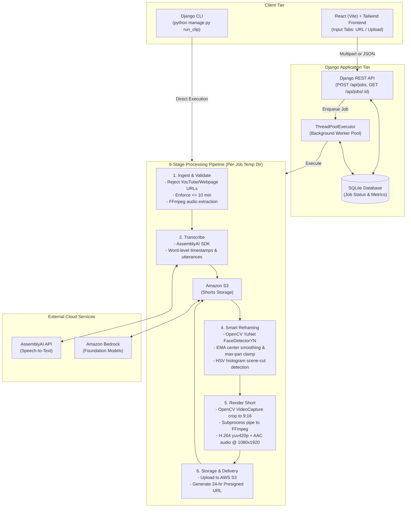

# Clip Cup — Architecture & Dataflow

Clip Cup is an automated computer-vision and AI pipeline that transforms long-form horizontal videos (up to 10 minutes) into one high-retention 9:16 vertical short (max 90 seconds) stored in AWS S3 with a presigned URL.

---

## High-Level Architecture Diagram

---

## Detailed Dataflow Breakdown

1. **Submission & Ingestion**:
   - Accepts either a direct video URL (.mp4, .mov, etc.) or a multipart file upload.
   - Enforces a 10-minute maximum video limit. Explicitly rejects non-direct URLs (e.g. YouTube web pages).
   - Video is downloaded or copied into a unique per-job temporary workspace directory (`/tmp/clipcup/clipcup_job_<id>_...`).
   - FFmpeg extracts a 16kHz mono PCM WAV audio stream for transcription.

2. **Speech Transcription**:
   - The audio stream is passed to the AssemblyAI SDK.
   - Generates full transcript with word-level start/end timestamps and speaker-labeled utterances.

3. **Viral Highlight Selection**:
   - The structured transcript is formatted and sent to Amazon Bedrock with strict prompt constraints:
     - Duration between 15s and 90s.
     - Strict JSON format: `{"start_ms", "end_ms", "topic", "reason"}`.
   - The bounds are validated and snapped to natural utterance boundaries.
   - Retries once on invalid JSON; falls back to the highest speech-density 60s sliding window on LLM failure.

4. **OpenCV 5 Smart Face-Tracking Reframing**:
   - Inspects the video segment using `cv2.FaceDetectorYN` (YuNet ONNX model).
   - Detects faces at sample intervals (every $N=5$ frames) and tracks speaker positions between frames.
   - Exponential Moving Average (EMA) smoothing prevents camera jitter.
   - Maximum pan speed limit prevents jarring snaps between speakers.
   - HSV histogram difference compares consecutive scenes: on a scene cut (correlation < threshold), the EMA center is immediately reset to the new subject's position.
   - Fallback to center-crop if no face is detected in the frame.
   - Computes reframing statistics: `face_hit_rate`, `avg_jitter_px`, `fallback_frames`, and `scene_cuts`.

5. **Streaming Video/Audio Render**:
   - OpenCV `VideoCapture` seeks to the segment start and crops each frame using the computed bounding box.
   - Resizes each frame to strict $1080 \times 1920$ (9:16 vertical HD).
   - Streams raw BGR24 bytes over stdin pipe into an FFmpeg subprocess.
   - FFmpeg encodes H.264 video (`yuv420p`, `-c:v libx264`) and muxes the synchronized segment audio (`-c:a aac -movflags +faststart`).
   - Deadlock-free process execution using managed error file buffering.

6. **Storage & Lifecycle Management**:
   - Uploads the final rendered short to AWS S3 (`shorts/<job_id>.mp4`).
   - Generates a secure 24-hour presigned GET URL.
   - **No persistent source storage**: The per-job temporary directory holding the source video and intermediate frames is deleted in a `finally` block immediately after upload.
